  

  <strong>Free, open-source tools for live public data, automation, markets and developers.</strong>
   
  Every tool on this page was cloned, installed and checked on 2 November 2026 -- the status next to each one says exactly what was verified.

  <a href="https://soclose.co">Website</a> &bull;
  <a href="https://github.com/SoCloseSociety">GitHub</a> &bull;
  <a href="https://x.com/socloseagency">X / Twitter</a> &bull;
  <a href="https://www.youtube.com/@socloseagency/">YouTube</a> &bull;
  <a href="mailto:contact@soclose.co">Contact</a>

  
  
  
  
  
  

 

  
  &nbsp;
  
  &nbsp;
  

  ⭐ <strong>Everything here is free.</strong> If a tool saves you time, a star is the best way to say thanks -- it helps others find it too.

---

### What we build

Open-source tools that save hours of manual work, in Python and TypeScript, MIT-licensed, self-hostable.

- 🌍 **Live public data** -- earthquakes, tsunamis and disasters from official agencies, El Nino / ENSO, public cameras
- 📺 **Self-hosted apps** -- free live TV and radio, media ingestion, a Mac cleaner and monitor, FPV drone tooling
- 📈 **Markets & crypto** -- a Bloomberg-style trading terminal, Solana anti-rug and whale trackers
- 🕷️ **Data extraction** -- Google Maps, LinkedIn, Meta Ads and more, to CSV / Excel
- 📣 **Social automation & AI agents** -- Pinterest, Instagram, X, Facebook, Telegram, and an LLM growth agent

**How to read the status column** -- we would rather tell you than let you find out:

| | Status | What it means |
|---|---|---|
| 🌐 | **Live** | A public demo answers today -- try it before you clone. |
| ✅ | **Tested** | Its own test suite or build passes on a fresh clone. |
| 🔌 | **Your account** | Installs and compiles cleanly, then runs against a site, API key or bot token of yours. We can't test that part for you, and sites change their pages: selector fixes are the most welcome PRs. |

---

### ✅ Verified working

<table>
<tr>
<td width="100%" align="center">

**[SOSForge](https://github.com/SoCloseSociety/SOSForge)** -- **Real-time earthquake, tsunami & disaster tracker -- 33 official sources in one live feed** &nbsp; 🌐 ✅

Thirty-three official feeds -- EMSC, USGS, NOAA, GDACS, JMA, BMKG, GeoNet, INGV, AFAD, GEOFON, NASA EONET, Meteoalarm, WMO and more -- merged into **one normalized stream** pushed to the browser over a websocket with a one-second heartbeat. Includes **Japan's earthquake early warning** and draws the **P and S wave fronts** live on the map. Built on one rule: **the feed never lies about its own freshness** -- every source shows its real health, and a partial outage degrades instead of going dark.

**33 sources** · **5 languages** · **Websocket live feed** · **P/S wave propagation** · **Cross-source dedup** · **1,900+ tests** · **Zero API keys**

**[Open the live map →](https://sosforge.soclose.co)** · **[View the repo →](https://github.com/SoCloseSociety/SOSForge)** · **[⭐ Star it](https://github.com/SoCloseSociety/SOSForge)**

</td>
</tr>
</table>

<table>
<tr>
<td width="100%" align="center">

**[elnino-watch](https://github.com/SoCloseSociety/elnino-watch)** -- **Live El Nino (ENSO) tracker with an explainable risk watch for Koh Samui -- 85 free public sources** &nbsp; 🌐 ✅

Follows the 2026-27 El Nino live from **NOAA, NASA, BoM, JMA, IRI, WMO, Copernicus, Open-Meteo, GDACS and the Thai agencies**, draws 22 satellite layers on a MapLibre map, and turns the local signals into a **five-level risk watch for Koh Samui** where every factor shows its value, threshold, source and explanation. Built on one rule: **never fabricate data** -- a stale or missing source is shown as such, and the level becomes "unknown", never "safe".

**85 sources** · **22 satellite layers** · **5-level explainable risk engine** · **240 help topics** · **470+ tests** · **Zero API keys**

**[Open the live site →](https://elnino.soclose.co)** · **[View the repo →](https://github.com/SoCloseSociety/elnino-watch)** · **[⭐ Star it](https://github.com/SoCloseSociety/elnino-watch)**

</td>
</tr>
</table>

<table>
<tr>
<td width="50%" align="center" valign="top">

**[neowatch](https://github.com/SoCloseSociety/neowatch)** &nbsp; 🌐 ✅

📺 About **12,000 freely published live TV channels**, internet radio and public-domain films in one fast player: 9-screen mosaic, TV guide, D-pad remote UX. React PWA + Node, hosts no content, self-hostable.

**[Try it live →](https://neowatch.soclose.co)**

</td>
<td width="50%" align="center" valign="top">

**[AegisForge](https://github.com/SoCloseSociety/AegisForge)** &nbsp; ✅

🛡️ A free, private **Mac cleaner & system monitor for developers** -- live TUI, node_modules / Docker / cache cleanup, security scan. macOS-first, 100% local, zero telemetry. One command to try it:

`uvx --from git+https://github.com/SoCloseSociety/AegisForge aegis gc --scan`

</td>
</tr>
</table>

| Tool | What it does | Status | |
|------|--------------|:---:|---|
| **[camforge](https://github.com/SoCloseSociety/camforge)** | Self-hosted world map of 7,000+ public traffic, weather and webcam feeds, relayed through your own media server, with a local AI vision relay (Ollama) | ✅ |  |
| **[meta-ads-extractor](https://github.com/SoCloseSociety/meta-ads-extractor)** | Export your Meta Ads campaigns, insights, creatives and leads to Excel through the official Graph API | ✅ |  |
| **[radiomaster](https://github.com/SoCloseSociety/radiomaster)** | FPV dashboard -- auto-detect and configure RadioMaster radios, Betaflight flight controllers and ELRS | ✅ |  |
| **[kontentmanager](https://github.com/SoCloseSociety/kontentmanager)** | Local-first media ingestion for macOS -- offload SD / USB / SSD cards cleanly, no cloud | ✅ |  |
| **[ClickGenerator](https://github.com/SoCloseSociety/ClickGenerator)** | Load testing, synthetic monitoring, SEO and accessibility audits, Playwright-powered | ✅ |  |

---

### 🏆 Most popular -- what the community stars and visits the most

Ranked by stars, then by unique visitors over the last 14 days. <strong>Use one? Star it ⭐</strong>

| # | Project | Why people use it | Status | ⭐ |
|---|---------|-------------------|:---:|---|
| 🥇 | **[MiloAgent](https://github.com/SoCloseSociety/MiloAgent)** | Self-learning AI growth agent for Reddit, X & Telegram -- needs your own Reddit API app | 🔌 |  |
| 🥈 | **[PinterestBulkPostBot](https://github.com/SoCloseSociety/PinterestBulkPostBot)** | Bulk-post to Pinterest: schedule pins, manage boards, CSV import | 🔌 |  |
| 🥉 | **[TradeBobbyTerminal](https://github.com/SoCloseSociety/TradeBobbyTerminal)** | Self-hosted Bloomberg-style ICT/SMC trading terminal -- 41 panels on free market data | 🔌 |  |
| 4 | **[GoogleMapScraper](https://github.com/SoCloseSociety/GoogleMapScraper)** | Business leads from Google Maps -- names, phones, websites, hours | 🔌 |  |
| 5 | **[InstagramMpBulkSender](https://github.com/SoCloseSociety/InstagramMpBulkSender)** | Bulk Instagram DMs with progress tracking and human-like delays | 🔌 |  |
| 6 | **[camforge](https://github.com/SoCloseSociety/camforge)** | Live world map of public cameras with a local AI vision relay | ✅ |  |
| 7 | **[neowatch](https://github.com/SoCloseSociety/neowatch)** | Free live TV, radio and films in one self-hosted app | 🌐 ✅ |  |
| 8 | **[FacebookInviteFriendToGroup](https://github.com/SoCloseSociety/FacebookInviteFriendToGroup)** | Bulk-invite Facebook friends to a group with smart delays | 🔌 |  |

---

### All tools

26 free, open-source tools -- <strong>star the ones you use</strong> so more people discover them ⭐

#### 🌍 Live public data & self-hosted apps

| Tool | Description | Status | |
|------|-------------|:---:|---|
| **[SOSForge](https://github.com/SoCloseSociety/SOSForge)** | Real-time earthquake, tsunami & disaster tracker -- 33 official sources, websocket feed, P/S wave fronts, [live map](https://sosforge.soclose.co) | 🌐 ✅ |  |
| **[elnino-watch](https://github.com/SoCloseSociety/elnino-watch)** | Live El Nino / ENSO tracker with an explainable risk watch -- 85 free sources, 22 satellite layers, [live site](https://elnino.soclose.co) | 🌐 ✅ |  |
| **[neowatch](https://github.com/SoCloseSociety/neowatch)** | Self-hostable free live TV, radio & film aggregator -- React PWA, HLS, EPG, TV UX, [live demo](https://neowatch.soclose.co) | 🌐 ✅ |  |
| **[camforge](https://github.com/SoCloseSociety/camforge)** | Self-hosted global map of public cameras with live relay and a local AI vision relay | ✅ |  |
| **[kontentmanager](https://github.com/SoCloseSociety/kontentmanager)** | Local-first media ingestion for macOS -- offload SD / USB / SSD cards cleanly, no cloud | ✅ |  |

#### 🖥️ Developer tools

| Tool | Description | Status | |
|------|-------------|:---:|---|
| **[AegisForge](https://github.com/SoCloseSociety/AegisForge)** | Mac cleaner & system monitor CLI for developers -- live TUI, cache / Docker / node_modules cleanup, 100% local | ✅ |  |
| **[ClickGenerator](https://github.com/SoCloseSociety/ClickGenerator)** | Load testing, synthetic monitoring, SEO & accessibility audits -- Playwright-powered | ✅ |  |
| **[radiomaster](https://github.com/SoCloseSociety/radiomaster)** | FPV drone dashboard -- auto-detect, configure and manage RadioMaster radios, Betaflight FCs and ELRS | ✅ |  |
| **[claude-code-template](https://github.com/SoCloseSociety/claude-code-template)** | Claude Code project template for AI-assisted development | 📄 |  |

#### 📈 Markets & crypto

| Tool | Description | Status | |
|------|-------------|:---:|---|
| **[TradeBobbyTerminal](https://github.com/SoCloseSociety/TradeBobbyTerminal)** | Bloomberg-style ICT/SMC trading terminal -- 41 panels, 15+ free data sources, Pine V6 indicator | 🔌 |  |
| **[RugscoreBotTG](https://github.com/SoCloseSociety/RugscoreBotTG)** | Solana anti-rug scanner -- 8-criteria scoring, Telegram bot, real-time on-chain data | 🔌 |  |
| **[WhalegodTG](https://github.com/SoCloseSociety/WhalegodTG)** | On-chain whale tracker for Solana & Ethereum -- 14 categories, labeled wallets, Telegram alerts | 🔌 |  |

#### 🕷️ Data extraction

| Tool | Description | Status | |
|------|-------------|:---:|---|
| **[meta-ads-extractor](https://github.com/SoCloseSociety/meta-ads-extractor)** | Export your Meta Ads campaigns, insights, creatives and leads to Excel -- official Graph API | ✅ |  |
| **[GoogleMapScraper](https://github.com/SoCloseSociety/GoogleMapScraper)** | Extract business data from Google Maps | 🔌 |  |
| **[LinkedinDataScraper](https://github.com/SoCloseSociety/LinkedinDataScraper)** | LinkedIn profile data at scale, Playwright + Streamlit UI | 🔌 |  |
| **[TwitterDataScraper](https://github.com/SoCloseSociety/TwitterDataScraper)** | Twitter / X profile data with dedup | 🔌 |  |
| **[InstagramDataScraper](https://github.com/SoCloseSociety/InstagramDataScraper)** | Instagram profile URLs at scale -- auto-scroll, filtering, dedup | 🔌 |  |
| **[FreeWorkDataScraper](https://github.com/SoCloseSociety/FreeWorkDataScraper)** | Freelancer profiles from Free-Work -- 18 fields, Streamlit UI, Excel export | 🔌 |  |
| **[DoctolibDataScraper](https://github.com/SoCloseSociety/DoctolibDataScraper)** | Doctor listings from Doctolib.fr | 🔌 |  |

#### 📣 Social automation & AI agents

| Tool | Description | Status | |
|------|-------------|:---:|---|
| **[MiloAgent](https://github.com/SoCloseSociety/MiloAgent)** | Self-learning AI growth agent -- Reddit expert, expanding to X & Telegram; runs on your own Reddit API app | 🔌 |  |
| **[PinterestBulkPostBot](https://github.com/SoCloseSociety/PinterestBulkPostBot)** | Bulk posting on Pinterest | 🔌 |  |
| **[InstagramMpBulkSender](https://github.com/SoCloseSociety/InstagramMpBulkSender)** | Bulk DMs on Instagram | 🔌 |  |
| **[TwitterMpBulkSender](https://github.com/SoCloseSociety/TwitterMpBulkSender)** | Bulk DMs on X / Twitter with retry logic and rate limiting | 🔌 |  |
| **[FacebookInviteFriendToGroup](https://github.com/SoCloseSociety/FacebookInviteFriendToGroup)** | Bulk-invite friends to Facebook groups | 🔌 |  |
| **[Telegram_ScrappingAdding_toGroup](https://github.com/SoCloseSociety/Telegram_ScrappingAdding_toGroup)** | Telegram group toolkit -- scrape a group's members and add them to yours with multi-account rotation | 🔌 |  |
| **[FrFollowForFollowBot](https://github.com/SoCloseSociety/FrFollowForFollowBot)** | Gamified Telegram follow-for-follow bot for Instagram (French) | 🔌 |  |

Can't pick just one? <a href="https://github.com/orgs/SoCloseSociety/repositories?q=sort%3Astars"><strong>Browse them all sorted by stars →</strong></a>

---

### 📈 Star History

  <a href="https://star-history.com/#SoCloseSociety/MiloAgent&SoCloseSociety/PinterestBulkPostBot&SoCloseSociety/TradeBobbyTerminal&SoCloseSociety/GoogleMapScraper&SoCloseSociety/neowatch&SoCloseSociety/camforge&Date">
    <picture>
      <source media="(prefers-color-scheme: dark)" srcset="https://api.star-history.com/svg?repos=SoCloseSociety/MiloAgent,SoCloseSociety/PinterestBulkPostBot,SoCloseSociety/TradeBobbyTerminal,SoCloseSociety/GoogleMapScraper,SoCloseSociety/neowatch,SoCloseSociety/camforge&type=Date&theme=dark">
      
    </picture>
  </a>

Help the curves go up -- <a href="https://github.com/orgs/SoCloseSociety/repositories?q=sort%3Astars"><strong>⭐ star a repo</strong></a>

---

### Tech Stack

  
  
  
  
  
  
  
  
  
  
  
  
  

---

### 🤝 Contributing & Support

All our tools are MIT-licensed and welcome contributions. Check each repo's `CONTRIBUTING.md` for guidelines.

**Three ways to support us -- the first two take 10 seconds:**

1. **⭐ Star** the repos you use -- [browse them all](https://github.com/orgs/SoCloseSociety/repositories?q=sort%3Astars). Stars are how GitHub ranks projects: every single one makes these free tools visible to more people.
2. **👀 Follow [@SoCloseSociety](https://github.com/SoCloseSociety)** -- be the first to know when we ship a new tool (we ship often).
3. **🍴 Fork & contribute** -- the most useful PR is often the smallest: a 🔌 tool whose target site changed its pages needs a selector update, and you are the one who just saw it break. Pick an [open issue](https://github.com/search?q=org%3ASoCloseSociety+is%3Aissue+is%3Aopen&type=issues) or open one -- first PR? We're friendly reviewers.

Found a bug or want a feature? [Open an issue](https://github.com/search?q=org%3ASoCloseSociety+is%3Aissue+is%3Aopen&type=issues) on the relevant repo -- we read everything.

---

  

  Built with purpose by <strong>SoClose</strong> -- Digital Innovation Through Automation & AI
   
  <a href="https://soclose.co">soclose.co</a> · <a href="https://x.com/socloseagency">@socloseagency</a> · <a href="mailto:contact@soclose.co">contact@soclose.co</a>

